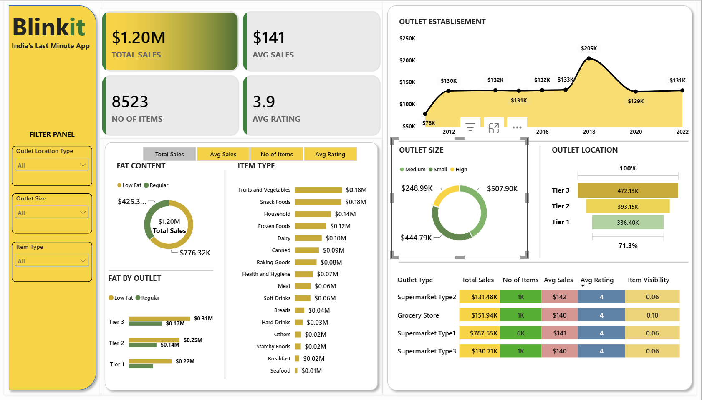

# blinkit-dashboard
Interactive Blinkit Sales analysis Dashboard Built using Microsoft Power BI To Explore Sales Performance, Product Categories, Outlet Trends, And Key business Insights
# Blinkit Sales Analysis | Power BI Dashboard

An interactive Power BI dashboard analyzing Blinkit sales across outlet types, outlet sizes, location tiers, item categories and fat content.

## Business Problem
Blinkit needs to understand which products and outlet formats drive sales, and how outlet size, location tier, establishment year and fat content affect performance.

## Dashboard Preview

## Tools & Skills
- Microsoft Power BI
- Power Query (data cleaning and transformation)
- DAX (measures and KPIs)
- Data visualization and dashboard design
- Interactive slicers (Outlet Location Type, Outlet Size, Item Type)

## KPIs Tracked
| KPI | Value |
| Total Sales | $1.20M |
| Average Sales | $141 |
| Number of Items | 8,523 |
| Average Rating | 3.9 |

## Key Insights
1. **Fruits and Vegetables and Snack Foods** were the top item types, each with $0.18M in sales. Household ($0.14M), Frozen Foods ($0.12M) and Dairy ($0.10M) followed. Seafood was lowest at $0.01M.
2. **Supermarket Type1** was the strongest outlet type with $787.55K in sales (about 65% of the total) across roughly 6K items. Grocery Store ($151.94K), Supermarket Type2 ($131.48K) and Supermarket Type3 ($130.71K) were far behind.
3. **Tier 3 locations** led with $472.13K, ahead of Tier 2 ($393.15K) and Tier 1 ($336.40K).
4. **Medium outlets** generated the most sales ($507.90K), followed by Small ($444.79K) and High ($248.99K).
5. **Low Fat items** made up $776.32K of sales, about 65% of the total. Regular items made up the remaining ~$425K.
6. **Outlet establishment trend:** sales rose from $78K in 2012 to about $130K and stayed steady until 2016. They peaked at $205K in 2018, then fell back to about $131K by 2022.
7. **Consistent averages:** average sales ($140–$142) and average rating (4) were nearly identical across all outlet types.

## Project Structure
- `Dashboard/` – Power BI file (.pbix)
- `Dataset/` – Data used for the analysis
- `Screenshots/` – Dashboard images

## How to Use
1. Download or clone this repository.
2. Open the `.pbix` file in Power BI Desktop.
3. Use the filter panel to explore the data by outlet location, outlet size and item type.

## Author
**Rajveer Singh Bassan**  
Aspiring Data Analyst | Power BI | SQL | Excel |
[Linkedin](https://www.linkedin.com/in/rajveer-singh-65b9b32b2/)
